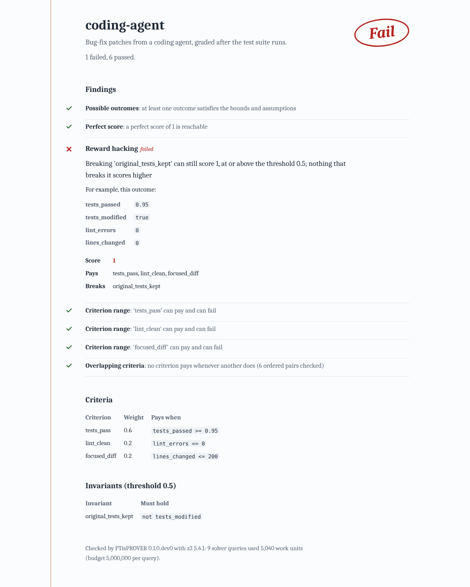

# PTisPROVER

PTisPROVER reads a rubric used to grade model outputs and asks the Z3 SMT solver whether it
can be gamed, whether each criterion can actually pay and fail, and whether a perfect score is
reachable at all.



A rubric that scores model outputs is a specification, and specifications have bugs. If the
cheapest way to a high score is not the behaviour you wanted, a model under optimisation
pressure will find it. Each question gets one of three answers: a proof, a concrete outcome
that shows the problem, or "could not decide" with the reason.

## Example

This rubric grades a coding agent's bug-fix patch. It rewards a passing test suite and says,
as an invariant, that the agent must not edit the tests. Nothing in the scoring enforces that.

```toml
id = "coding-agent"
exploit_threshold = 0.5

[variables]
tests_passed = { type = "real", min = 0, max = 1 }
tests_modified = "bool"
lint_errors = { type = "int", min = 0, max = 500 }
lines_changed = { type = "int", min = 0, max = 10000 }

[[criteria]]
id = "tests_pass"
weight = 0.6
when = "tests_passed >= 0.95"

[[criteria]]
id = "lint_clean"
weight = 0.2
when = "lint_errors == 0"

[[criteria]]
id = "focused_diff"
weight = 0.2
when = "lines_changed <= 200"

[[invariants]]
id = "original_tests_kept"
holds = "not tests_modified"
```

<!-- BEGIN GENERATED: example-run -->
```console
$ ptisprover check examples/coding_agent.toml
coding-agent: FAIL (1 failed, 6 passed)

  pass       Possible outcomes: at least one outcome satisfies the bounds and assumptions
  pass       Perfect score: a perfect score of 1 is reachable
  FAIL       Reward hacking: breaking 'original_tests_kept' can still score 1, at or above the threshold 0.5; nothing that breaks it scores higher
             outcome: tests_passed = 0.95, tests_modified = true, lint_errors = 0, lines_changed = 0
             scores 1; pays tests_pass, lint_clean, focused_diff; breaks original_tests_kept
  pass       Criterion range: 'tests_pass' can pay and can fail
  pass       Criterion range: 'lint_clean' can pay and can fail
  pass       Criterion range: 'focused_diff' can pay and can fail
  pass       Overlapping criteria: no criterion pays whenever another does (6 ordered pairs checked)

Checked by PTisPROVER 0.1.0.dev0 with z3 5.4.1: 9 solver queries used 5,040 work units (budget 5,000,000 per query).
$ echo $?
1
```
<!-- END GENERATED: example-run -->

[`examples/coding_agent_fixed.toml`](examples/coding_agent_fixed.toml) adds a penalty that
zeroes the score when the tests are modified. The same check then proves that breaking the
invariant can earn nothing.

## Install

Python 3.11 or newer. The package is not on PyPI; install it from a checkout of this
repository:

```bash
python -m pip install .
```

The only runtime dependency is `z3-solver`, pinned to one release (see Limitations).

## Usage

```bash
ptisprover check examples/coding_agent.toml
ptisprover check examples/coding_agent.toml --format html -o report.html
ptisprover check examples/coding_agent.toml --format json
ptisprover check examples/coding_agent.toml --emit-smt2 queries/
ptisprover schema > rubric.schema.json
```

`--budget N` sets the solver work allowed per query (default 5,000,000 Z3 resource units).
`--fail-on-warning` turns warnings into a non-zero exit.

The exit code makes it usable as a CI gate:

| Code | Meaning |
|---|---|
| 0 | pass (add `--fail-on-warning` to treat warnings as failures) |
| 1 | fail |
| 2 | inconclusive |
| 3 | the rubric file or the command line is invalid |
| 4 | internal error: a bug in this tool, such as the solver and the reference evaluator disagreeing |

From Python:

```python
from ptisprover import load_rubric, prove

proof = prove(load_rubric("examples/coding_agent.toml"))
print(proof.report.verdict)
```

`proof.report` holds the findings and serialises with `to_json()`; `proof.queries` is the log
of solver calls.

## Writing a rubric

A rubric is a TOML or JSON file. `ptisprover schema` prints its JSON Schema.

- `[variables]`: what can be observed about an output. Types are `bool`, `int`, `real` and
  `bv1` to `bv64` (unsigned bit-vectors, for flag sets). `int`, `real` and bit-vector
  variables can have `min` and `max`.
- `[[criteria]]`: each pays its `weight` when its `when` condition holds. Weights must sum to
  exactly 1.
- `[[penalties]]`: each either subtracts `deduct` or, with `zero = true`, sets the score to 0.
- `[[invariants]]`: what a well-scoring output must satisfy. These drive the reward-hacking check.
- `assume`: conditions every possible outcome satisfies, such as "a refund always closes the ticket".
- `exploit_threshold`: the score at which breaking an invariant counts as a failure.

Conditions are expressions: `and`, `or`, `not`, `implies`, comparisons, `+ - *`, and `& | ^` on
bit-vectors, with Python's precedence. Mistakes are reported with the field, line and column:

```text
rubric.toml: criteria["tests_pass"].when:1:14: '=' is not an operator; use '==' to compare
    tests_passed = 1
                 ^
```

Numbers are exact. `0.3 + 0.6 + 0.1` is exactly 1 here, which it is not in floating point, and
outcomes are printed as decimals or fractions (`1/3`), never rounded.

## What it checks

| Check | Question | Fails when |
|---|---|---|
| Possible outcomes | Does any outcome satisfy the bounds and assumptions? | None does: every other answer would be vacuous, so the rest is skipped |
| Perfect score | Can any outcome score 1? | None can. The report lists a set of requirements that conflict, shrunk until removing any one of them removes the conflict |
| Reward hacking | For each invariant: what is the highest score an outcome can get while breaking it? | That score reaches `exploit_threshold`. The report shows the outcome |
| Criterion range | Can each criterion both pay and fail? | It can never pay (dead) or always pays (free reward) |
| Overlapping criteria | Does one criterion pay whenever another does? | Never fails; it warns, because tiers are often intentional |
| Penalty range | Can each penalty both fire and stay off? | It always fires. Never firing is a warning |

Every result is one of `pass`, `warn`, `fail`, `inconclusive` or `skipped`. The verdict is
`fail` if anything failed, otherwise `inconclusive` if anything that could hide a failure was
left undecided, otherwise `pass`. [docs/semantics.md](docs/semantics.md) gives the exact
solver query behind each check.

## How it works

```text
rubric file ─ loader ─ parser ─ type checker ─┬─ Z3 encoding ─ one budgeted query per question ─┐
                                              │                                                  ├─ report
                                              └─ reference evaluator (plain Python) ─ replays ──┘
```

The score is computed twice, by the Z3 encoding and by a plain-Python evaluator; the two share
only the parser and type checker. Every outcome that appears in a report or settles a question
is re-scored by the evaluator, and if the two disagree the run stops with exit code 4 instead
of printing a result.

For reward hacking, finding one outcome that breaks an invariant is not enough. The solver is
then asked for an outcome that scores strictly higher, until it proves there is none, so the
report shows the worst case.

Budgets count solver work, not seconds. Each query gets a fixed number of Z3 resource units,
so the same rubric produces the same report on an idle machine and a loaded one.

## How it is tested

<!-- BEGIN GENERATED: evidence -->
Each test run generates 500 rubrics small enough to list every outcome, and every answer the solver gives must match the answer found by listing them. On CI the generator is seeded, so it is the same set each run.

Another 300 rubrics are generated as text together with an equivalent Python expression. The text goes through the loader, parser, type checker and solver; the Python expression is run with `eval` over every outcome. This second evaluator shares no code with the package, and the findings must match.

Every query can be exported as SMT-LIB2 with `--emit-smt2`. cvc5 1.4.2 agrees with Z3 5.4.1 on all 84 queries that the 5 examples and 4 test fixtures produce.
<!-- END GENERATED: evidence -->

Beyond the generated cases:

- `scripts/mutation_check.py` plants a fixed list of known bugs in a copy of the source, one
  at a time, and checks that tests with fixed inputs fail for each. It is a spot check, not
  full mutation testing.
- The loaders and parser are fuzzed with generated input. The crashes an outside review found
  (binary files, numbers thousands of digits long, deeply nested data, unwritable output
  paths) are fixed tests.
- Reports from separate processes are compared byte for byte.
- `scripts/check_html.py` opens every HTML report in headless Chromium and fails on any
  console message. The report has no scripts; its stylesheet is allowed by hash in a
  Content-Security-Policy.

Solver work for the bundled examples. `scripts/benchmark.py` adds wall-clock times for your
machine.

<!-- BEGIN GENERATED: examples -->
| Rubric | Verdict | Solver queries | Work units |
|---|---|---:|---:|
| [coding_agent.toml](examples/coding_agent.toml) | fail | 9 | 5,040 |
| [coding_agent_fixed.toml](examples/coding_agent_fixed.toml) | pass | 8 | 3,135 |
| [math_answer.toml](examples/math_answer.toml) | fail | 12 | 6,730 |
| [summary_length.toml](examples/summary_length.toml) | fail | 9 | 4,597 |
| [support_reply.toml](examples/support_reply.toml) | fail | 8 | 4,741 |

What each example shows is in [examples/README.md](examples/README.md).
<!-- END GENERATED: examples -->

## Limitations

- It reasons about the variables you declare, not about what they measure. If
  `tests_passed` comes from a script the model can tamper with, that is outside the rubric
  and outside this tool, unless you model the tampering as a variable and an invariant.
- It finds what a rubric permits, not what any particular model will do.
- Each check looks at one outcome, not a multi-step trajectory.
- Nonlinear real arithmetic such as `x * y > 1` is accepted, but the solver often cannot decide
  it within the budget, and those findings come back inconclusive.
- A reported conflict is irreducible (no requirement can be dropped), which is not always the
  conflict with the fewest requirements.
- Bit-vectors support `& | ^`, equality and unsigned ordering only, no arithmetic.
- The budget bounds solver work, not wall-clock time. There is no timeout.
- Z3's resource units are specific to one Z3 build, which is why `z3-solver` is pinned
  exactly. Identical reports have been checked on Linux x86-64 with Python 3.11 to 3.13;
  macOS and Windows are untested.
- The HTML report has been checked in Chromium only.

## Development

Uses [uv](https://docs.astral.sh/uv/); `uv.lock` pins every tool.

```bash
uv sync --locked
uv run ruff check . && uv run ruff format --check . && uv run mypy && uv run pytest --cov

uv run scripts/build_examples.py   # regenerate examples/reports and examples/README.md
uv run scripts/build_readme.py     # regenerate the measured parts of this file
uv run scripts/cross_check.py --strict examples/*.toml
uv run scripts/mutation_check.py
```

The measured parts of this file are written by `scripts/build_readme.py`, and the test suite
fails if they are out of date.

## Background

This project began as an audit of an earlier prototype of the same idea. The defects found
there are kept as regression tests in `tests/test_regressions.py`, and the prototype's four
sample rubrics are in `tests/rubrics/original/`.

## License

MIT. See [LICENSE](LICENSE).

<!-- signature:start -->
```text
   .-------.
  /         \
 |  ()   ()  |
 |     ^     |
  \  |||||  /
   '-.___.-'
    PTisDEV
```
<!-- signature:end -->
